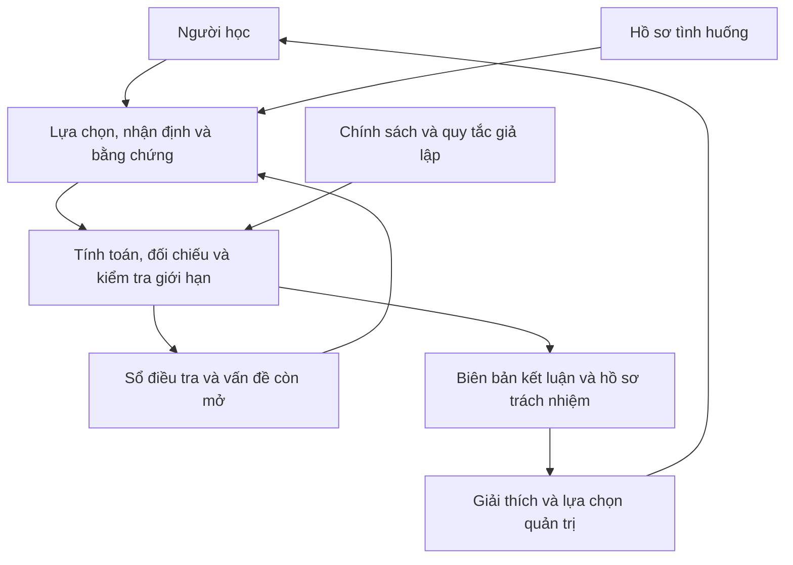

# WEEK 2 — SOLUTION STRUCTURE

**Dự án:** The Last Heir  
**Học phần:** NHA408E · **Nhóm:** G08 · **Tuần:** 2

## 1. Purpose and Design Context

Tài liệu mô tả cách The Last Heir biến hồ sơ tình huống và lựa chọn của người học thành kết luận kiểm soát, trách nhiệm và quyết định quản trị. Phần vấn đề, người dùng và lý do chọn sản phẩm nằm trong [PROJECT-PROPOSAL.md](PROJECT-PROPOSAL.md).

Đầu ra trung tâm là biên bản kết luận về NST-01. Năm chương tạo chuỗi từ dấu hiệu tài chính đến ranh giới giao dịch, kiểm tra kiểm soát và quy trách nhiệm. Mỗi chương phải giữ kết luận trong phạm vi bằng chứng đã mở.

## 2. User–Input–Process–Output–User

Người học tiếp cận hồ sơ, đưa ra lựa chọn, nhận kết quả đối chiếu rồi xem lại nguồn nếu cần. Các nhận định đã xác nhận tạo đầu vào cho bước tiếp theo; quá trình này kết thúc bằng kết luận và hành động quản trị.

| Thành phần | Nội dung cụ thể |
|---|---|
| Người dùng | Sinh viên có kiến thức tài chính và kiểm soát nội bộ cơ bản |
| Đầu vào do trò chơi cung cấp | Báo cáo, kế hoạch, sổ chi tiết, hợp đồng, chính sách, nhật ký, ngoại lệ và lời khai |
| Đầu vào do người học tạo | Phương án phân tích, vai trò chứng từ, nhóm bút toán, nhận định kiểm soát và kết luận trách nhiệm |
| Xử lý | Kiểm tra điều kiện, tính toán, đối chiếu nguồn, kiểm tra tính đầy đủ và giới hạn kết luận |
| Đầu ra | Hồ sơ đã xác nhận, biên bản kết luận và đánh giá quá trình học |
| Hành động tiếp theo | Giải thích kết luận, xác định việc cần điều tra thêm và lựa chọn xử lý quản trị |

## 3. Backward Mapping from Output

Mỗi kết quả cần có cơ sở truy xuất ngược. Một khoản tiền khớp, một trạng thái hệ thống hoặc một quan hệ gia đình không tự tạo thành kết luận về trách nhiệm.

| Kết quả cần tạo | Logic xử lý | Đầu vào thiết yếu | Thành phần |
|---|---|---|---|
| Giải thích tăng doanh thu | Cầu nối sản lượng, giá và cơ cấu; đối chiếu phải thu | Báo cáo hai năm, cầu nối và tuổi nợ | Chương I |
| Khoản chi phí cần phân tích tiếp | Phân tích cơ cấu; so kế hoạch với thực tế | Kế hoạch được duyệt, sổ và chứng từ chi phí | Chương I |
| Tư vấn còn chênh lệch 2,6 | Gán đúng vai trò nguồn và kiểm tra giải trình | Năm tài khoản, ngân sách, sổ và tài liệu bối cảnh | Chương II |
| NST-01 là giao dịch 2,6 | Cùng hợp đồng, cùng mục đích, đủ bút toán | Sổ tư vấn, hợp đồng và bàn giao | Chương III |
| Nhận định phân luồng và ngoại lệ | So yêu cầu thẩm quyền với cách xử lý | FIN-*, nhật ký, sự cố và hồ sơ ngoại lệ | Chương IV |
| Cơ sở điều tra khả năng vô hiệu hóa kiểm soát | Tổng hợp thiếu sót hệ thống và phần cần giải thích về con người | Các kết quả Chương IV | Chương IV |
| Trách nhiệm từng người | Kết nối thẩm quyền, hiểu biết và hành động | Dữ kiện chuyển tiếp, hồ sơ bổ sung và lời khai | Chương V |
| Biên bản kết luận | Tách kiểm soát, xung đột lợi ích và rủi ro gian lận | Hồ sơ trách nhiệm và hồ sơ Northstar | Chương V |
| Kết quả kế nhiệm | Tính điểm và xét điều kiện kết thúc | Tiến trình và ba quyết định quản trị | Sau điều tra |

## 4. Chapter I — Financial Review

Người học bắt đầu từ báo cáo tài chính hai năm để kiểm tra doanh thu, biên lợi nhuận và dòng tiền. Số liệu tiền tệ dùng triệu USD.

Doanh thu tăng từ 120,0 lên 150,0, tương đương 25,0%. Cầu nối gồm ảnh hưởng sản lượng 20,4 và ảnh hưởng giá, cơ cấu 9,6. Phải thu tăng 16,7%; số ngày thu tiền ước tính giảm từ 54,8 xuống 51,1. Kết quả hỗ trợ giải thích cấp tổng hợp, chưa xác minh riêng mọi giao dịch doanh thu.

Biên lợi nhuận hoạt động giảm từ 18,6% xuống 13,7%. Người học xác định các dòng gây bất lợi rồi đọc kế hoạch, sổ và chứng từ. Cần giữ riêng biến động giữa hai năm với chênh lệch so kế hoạch:

| Khoản mục | Biến động 2024–2025 | Thực tế 2025 so với kế hoạch 2025 |
|---|---|---|
| Biên lợi nhuận gộp | Giảm khoảng 2,5 điểm phần trăm | 43,3% so với 44,0%; thấp hơn khoảng 0,7 điểm |
| Tiếp thị và quản lý | Tăng 6,0 | 21,0 − 18,0 = +3,0 |
| Nghiên cứu và phát triển | Tăng 1,6 | 6,1 − 6,0 = +0,1 |
| Chi phí hoạt động khác | Tăng 2,5 | 6,9 − 6,7 = +0,2 |

Chứng từ nghiên cứu và phát triển giải thích phần tăng 1,6; chứng từ RC-25 giải thích phần tăng 2,5. Những số này không được ghi thành mức vượt kế hoạch. Khoản tiếp thị và quản lý vượt kế hoạch 3,0 tiếp tục được phân rã ở Chương II.

Dòng tiền năm 2025 gồm kinh doanh 11,0; đầu tư −11,0; tài trợ −2,0, khớp tiền giảm từ 8,0 xuống 6,0. Truy được nguồn dòng tiền không đồng nghĩa mọi quyết định kinh tế đều tối ưu.

## 5. Chapter II — Cost Breakdown

Người học phân rã khoản chênh lệch 3,0 qua năm tài khoản. Nhân sự là ví dụ hướng dẫn; bốn tài khoản còn lại yêu cầu tự gán chứng từ vào vai trò.

| Tài khoản | Ngân sách | Thực tế | Chênh lệch | Kết quả trong tình huống |
|---|---:|---:|---:|---|
| Nhân sự | 8,7 | 9,0 | +0,3 | Có đối chiếu thời điểm tuyển và lương |
| Tiếp thị và hỗ trợ bán hàng | 4,4 | 4,5 | +0,1 | Có đối chiếu giá truyền thông |
| Pháp lý và đăng ký | 1,6 | 1,8 | +0,2 | Có chứng từ phí bổ sung |
| Tư vấn | 1,6 | 4,2 | +2,6 | Chưa có giải trình định lượng phần chênh lệch |
| Khác | 1,7 | 1,5 | −0,2 | Có đối chiếu công tác hủy hoặc hoãn |
| **Tổng** | **18,0** | **21,0** | **+3,0** | |

Bốn vai trò là cơ sở được phê duyệt, số thực tế ghi nhận, giải trình định lượng và bối cảnh. Dự báo nháp tháng 9 khoảng 4,0 không thay ngân sách tư vấn 1,6 nếu chưa có điều chỉnh được phê duyệt.

Kết luận chương chỉ xác định nhu cầu truy vết 2,6. Một khoản chưa được giải trình không tự chứng minh hành vi sai phạm.

## 6. Chapter III — Transaction Trace

Sổ tư vấn gồm chín bút toán, bốn nhà cung cấp, bảy hợp đồng và chín hồ sơ bàn giao. Người học chọn nhóm giả thuyết, đọc hai loại hồ sơ cho mỗi khoản được chọn, rồi kiểm tra ranh giới và mức đầy đủ.

- NS-051: 0,9; NS-073: 0,9; NS-101: 0,8 cùng NST-01 và mục đích ROP-25, tổng 2,6.
- NS-119: 0,2 cũng thuộc Northstar Advisory nhưng NST-02 và TAX-25, nên nằm ngoài giao dịch này.
- Chọn thiếu khoản trong NST-01 tạo nhóm chưa đầy đủ; thêm khoản khác hợp đồng hoặc mục đích làm nhóm không còn một ranh giới.

Cùng nhà cung cấp hoặc cộng được đúng tổng chưa đủ. Kết luận xác lập giao dịch và giá trị; chủ ý chia nhỏ, hành vi vô hiệu hóa kiểm soát và trách nhiệm thuộc các bước sau.

## 7. Chapter IV — Control Investigation

### 7.1 Build and Apply the Checklist

Người học dựng bảng kiểm từ FIN-AUTH-05, FIN-PROC-11 và vai trò liên quan. Bốn bước gồm xác định khoản liên quan, cộng tổng, so ma trận thẩm quyền và chuyển cấp trước khi tiếp tục nếu cần.

| Tổng giá trị theo mô hình | Thẩm quyền tối thiểu |
|---|---|
| Không quá 0,5 | Trưởng bộ phận |
| Trên 0,5 đến 1,0 | Trưởng bộ phận và quản lý tài chính |
| Trên 1,0 | Giám đốc tài chính và Hội đồng quản trị |

| Ngày năm 2025 | Khoản hiện tại | Tổng đã phát sinh sau khoản | Cấp theo mô hình cộng dồn |
|---|---:|---:|---|
| 08/05 | 0,9 | 0,9 | Trưởng bộ phận và quản lý tài chính |
| 19/07 | 0,9 | 1,8 | Giám đốc tài chính và Hội đồng quản trị |
| 14/10 | 0,8 | 2,6 | Giám đốc tài chính và Hội đồng quản trị |

Mốc 19/07 là lần đầu tổng đã phát sinh trong mô hình trò chơi vượt 1,0. Trần hợp đồng 2,8 là trường thông tin khác; thời điểm cam kết toàn bộ chưa được mô tả đầy đủ, nên không mở rộng mốc này thành kết luận về mọi nghĩa vụ phê duyệt ban đầu.

### 7.2 Test Routing and Exceptions

Nhật ký 10:48 ngày 19/07 sử dụng giá trị hiện tại 0,9 và không tạo nhiệm vụ cấp giám đốc tài chính. Sự cố cổng phê duyệt bắt đầu 10:51, sau khi luồng đã được tạo; sự cố không giải thích lỗi cơ sở giá trị trước đó.

| Nhóm hồ sơ | Nội dung điều tra |
|---|---|
| NS-051 | Kiểm tra ủy quyền cho Maya và quyết định gắn với PR-117 |
| NS-073 | Sự cố có thật nhưng cách xử lý thay thế vẫn phải giữ cấp; kiểm tra ô tổng và bằng chứng phê duyệt |
| NS-101 | Loại ngoại lệ thời hạn pháp lý không khớp thư về mốc nội bộ; nhật ký hàng đợi chung chưa định danh người thao tác cuối |
| Giám sát | Tự chọn ba dòng NST-01 trong báo cáo mười dòng và đối chiếu IC-25-104 |

### 7.3 Establish and Transfer Facts

Hai bước đầu dựng và áp dụng bảng kiểm không yêu cầu người học ghim dữ kiện. Từ phần ngoại lệ, người học chọn dữ kiện liên quan để hỗ trợ nhận định. Nhận định phân luồng được khóa cũng xác lập các dòng nhật ký tương ứng.

Dữ kiện đã xem hoặc đang chọn chưa mặc nhiên được chuyển tiếp. Chỉ dữ kiện gắn với nhận định được xác nhận mới mang trạng thái đã xác lập. Chương IV dừng ở mức **có cơ sở điều tra khả năng nhà quản lý vô hiệu hóa kiểm soát**, chưa quy hành vi chủ động cho cá nhân.

## 8. Chapter V — Board Inquiry

Chương V có năm lời khai của bốn nhân chứng. Người học chọn đúng tập hồ sơ và đánh giá chính xác lời khai bị bác bỏ, được hỗ trợ một phần, được hỗ trợ có giới hạn hoặc được hỗ trợ.

Thông báo rà soát 11:09, nhật ký mở thư 11:12 và 11:14, biểu mẫu 11:23 cùng lịch sử xử lý bổ sung bằng chứng về hiểu biết và hành động. Các hồ sơ cần thiết chưa được chuyển từ Chương IV có thể được yêu cầu lại; chúng không được gọi là dữ kiện đã kế thừa nếu chưa từng được xác lập.

| Nhân vật | Kết luận của tình huống | Giới hạn |
|---|---|---|
| Victor Hale | Chịu trách nhiệm chính về hành vi chủ động vô hiệu hóa kiểm soát | Dựa trên thẩm quyền, biết tổng cụ thể và thao tác trực tiếp |
| Lucas Meyer | Có thiếu sót kiểm soát; chưa đủ bằng chứng hành vi chủ động tương tự | Không đồng nghĩa hoàn toàn không có trách nhiệm |
| David Cole | Chưa đủ bằng chứng quy lỗi cá nhân | Không nhận nhiệm vụ hệ thống không chứng minh không biết qua mọi kênh |
| Sophia Lin | Có bằng chứng thực hiện giám sát sau giao dịch | Không khẳng định toàn bộ hoạt động giám sát đều hiệu quả |

Mỗi nhân chứng có cửa sổ chất vấn 90 giây; Victor dùng chung cho hai lời khai. Hết giờ chỉ làm mất điểm lời khai chưa hoàn thành, không hủy kết quả đã được chấp nhận và không chặn bước đánh giá trách nhiệm.

Hồ sơ Northstar mở sau khi bốn hồ sơ trách nhiệm đã khóa. Elena, vợ Victor, sở hữu 70% Northstar; việc không khai báo làm tăng rủi ro xung đột lợi ích. Kết luận cuối phân biệt hành vi vô hiệu hóa kiểm soát đã được quy cho Victor với gian lận mới ở mức rủi ro cần điều tra độc lập.

## 9. Minimum Viable Product and Scope

Phiên bản khả dụng tối thiểu cần tạo một hành trình hoàn chỉnh từ dấu hiệu đến kết luận có bằng chứng. Năm chương là năm bước lập luận, nhưng số lượng hồ sơ và lớp trình bày có thể rút gọn.

| Nhóm phạm vi | Nội dung |
|---|---|
| Bắt buộc | Một tình huống; khoanh vùng chênh lệch; phân loại chứng từ; ranh giới giao dịch; kiểm tra kiểm soát; kiểm tra lời khai; kết luận có căn cứ |
| Bắt buộc | Lưu kết quả đã xác nhận, xem lại nguồn và hỗ trợ tiếp tục khi gặp khó khăn |
| Mở rộng của bản hoàn chỉnh | Phim mở đầu, hình ảnh, âm thanh, chuyển cảnh, bộ đếm thời gian, ba quyết định kế nhiệm và bốn phim kết thúc |
| Ngoài phạm vi | Dữ liệu doanh nghiệp thật, nhiều vụ việc ngẫu nhiên, mô hình trí tuệ nhân tạo, tài khoản và máy chủ dữ liệu |
| Ngoài phạm vi học thuật | Đánh giá toàn bộ COSO hoặc SOX, mô hình Beneish, chấm tam giác gian lận, phán quyết pháp lý về gian lận |

Phương án dự phòng là giảm số tài liệu gây nhiễu và nội dung đa phương tiện, dùng giao diện đơn giản và trạng thái trong phiên. Các bước lập luận cốt lõi vẫn được giữ.

## 10. Scoring, Assistance and Endings

Điểm đánh giá quá trình thực hiện, không quyết định sự thật của vụ việc. Có 45 điểm kiểm tra: Chương I có 9; II có 6; III có 2; IV có 17; V có 11.

| Nhóm điểm | Tối đa | Ý nghĩa |
|---|---:|---|
| Chất lượng điều tra | 35 | Mức làm chủ các điểm kiểm tra |
| Kỷ luật lập luận | 30 | Hạn chế lỗi mới lặp lại và tỷ lệ tự giải |
| Quản trị | 25 | Hồ sơ trách nhiệm tự giải và ba quyết định cuối |
| Mức tự thực hiện | 10 | Phản ánh việc sử dụng gợi ý và lời giải |

Không quá một lần sai vẫn giữ mức làm chủ đầy đủ; hai lần còn một nửa; từ ba lần không nhận điểm làm chủ. Từ lần sai thứ hai, câu hỏi tạm dừng đến khi mở lại hồ sơ hoặc hết 15 giây; lần thứ ba mở gợi ý. Các đáp án sai đã được ghi nhận không được tính lại nếu không có lỗi mới theo cơ chế của câu hỏi.

| Thứ tự xét | Điều kiện | Kết thúc |
|---|---|---|
| 1 | Ít nhất hai quyết định vội vàng, hoặc có một quyết định vội vàng và kỷ luật không quá 20 | Hoãn kế nhiệm do xử lý vội vàng |
| 2 | Ít nhất hai quyết định do dự, sau khi không thuộc điều kiện 1 | Hoãn kế nhiệm do thiếu quyết đoán |
| 3 | Ba quyết định cân bằng; kỷ luật ít nhất 24; tự thực hiện ít nhất 5; tổng ít nhất 80 | Chấp thuận kế nhiệm |
| 4 | Các trường hợp còn lại | Kế nhiệm có giám sát |

Ba quyết định liên quan đến Victor, Northstar và hệ thống kiểm soát. Lựa chọn cân bằng bảo toàn hồ sơ, hạn chế xung đột, điều tra độc lập và sửa kiểm soát; tránh coi gian lận đã được chứng minh hoặc giữ nguyên rủi ro chỉ vì chưa có phán quyết cuối.

## 11. Technical Route and Feasibility

Bản hoàn chỉnh dùng HTML, CSS và JavaScript, đóng gói trong một HTML. Năm chương được nén và nhúng; trình duyệt giải nén rồi mở trong khung nội dung. Dữ liệu vận hành được khai báo trong mã từng chương, còn trạng thái chung được quản lý bởi `window.TLH_GAME`.

| Thành phần | Triển khai |
|---|---|
| Giao diện | HTML và CSS |
| Xử lý | JavaScript theo quy tắc cố định |
| Nguồn dữ liệu khi chạy | Đối tượng và mảng nhúng trong mã |
| Đóng gói chương | gzip, base64 và `DecompressionStream` |
| Trạng thái | Bản ghi dùng chung và lưu trình duyệt khi khả dụng |
| Phân phối | Một tệp; không cần máy chủ ứng dụng hoặc đăng nhập |
| Rủi ro thực tế | Dung lượng khoảng 120,5 MB; khả năng lưu tệp cục bộ và tốc độ tùy trình duyệt, thiết bị |

README ghi nhận thay đổi từ Unity/C# sang công nghệ web để giảm độ phức tạp phân phối. Việc chuyển công nghệ giữ nhiệm vụ và chuỗi lập luận; không coi tính năng công nghệ là phát biểu vấn đề của Tuần 1.

## 12. Implementation Ownership and Handoff

| Thành phần | Phụ trách chính | Đầu ra để đối chiếu ở Tuần 3 |
|---|---|---|
| Mục tiêu và tính thống nhất | Phạm Quỳnh Phương | Tổng quan, danh mục bàn giao và phạm vi |
| Chương I–III | Phạm Triệu Tiến Dũng | Từ điển tài chính, dữ liệu mẫu, hợp đồng và giao dịch |
| Kiểm tra và điểm | Nguyễn Minh Hiền | Kiểm tra đầu vào, kiểm tra logic và quy tắc điểm |
| Hồ sơ Chương IV–V | Tôn Khánh Ngọc | Danh mục nguồn, giả định và giới hạn kết luận |
| Tích hợp | Đinh Thị Minh Khuê | Ánh xạ dữ liệu với HTML, trạng thái và chuyển chương |

[Bảng phân công đầy đủ](PROJECT-PROPOSAL.md) gắn người phụ trách với sản phẩm và phụ thuộc. [Tuần 3](../WEEK_3/OVERVIEW_FINAL.md) cụ thể hóa cấu trúc trên thành trường dữ liệu, nguồn, giả định, dữ liệu mô phỏng và kiểm tra sớm.

## 13. Solution Review Record

Cấu trúc đã chỉ rõ đầu vào, quy tắc xử lý, đầu ra và giới hạn của từng chương. Số liệu và quy tắc được đối chiếu với mã trò chơi; các kết quả kiểm tra sớm được trình bày riêng trong [DATA_FLOW_FINAL.md](../WEEK_3/DATA_FLOW_FINAL.md).

Các phần cần kiểm tra tiếp gồm luồng giao diện hoàn chỉnh, khả năng lưu và khôi phục trên trình duyệt thực tế, thời gian chất vấn và hiệu quả học tập. Không suy ra các kết quả này chỉ từ việc cấu trúc tài liệu đã đầy đủ.
