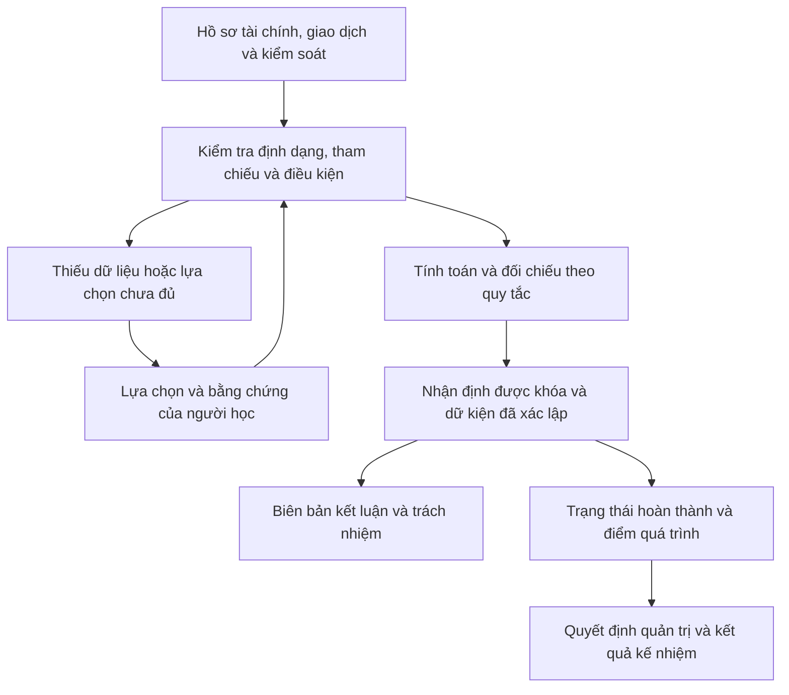

# WEEK 3 — DATA FLOW AND EARLY LOGIC CHECKS

**Dự án:** The Last Heir  
**Học phần:** NHA408E · **Nhóm:** G08 · **Tuần:** 3

## 1. Purpose and Evidence Scope

Tài liệu mô tả đường đi từ nguồn và lựa chọn của người học đến đầu ra, cách kiểm tra dữ liệu, dữ liệu mô phỏng đầy đủ và kết quả kiểm tra sớm. Nguồn và ý nghĩa trường được ghi tại [SOURCES_FINAL.md](SOURCES_FINAL.md) và [INPUT_DICTIONARY_FINAL.md](INPUT_DICTIONARY_FINAL.md).

Dữ liệu số hóa nằm trong thư mục `DATA`. Các bảng dưới đây giúp kiểm tra bằng tay và đối chiếu với trò chơi; phần chứa kết luận là tài liệu bàn giao học thuật, không phải màn hình đáp án hiển thị trước cho người học.

## 2. End-to-End Data Flow



| Chặng | Xử lý | Đầu ra chuyển tiếp |
|---|---|---|
| I | Cầu nối doanh thu; phải thu; cơ cấu; kế hoạch; dòng tiền | Tiếp thị và quản lý vượt kế hoạch 3,0 |
| II | Phân loại vai trò và kiểm tra giải trình | Tư vấn còn 2,6 cần truy vết |
| III | Cùng hợp đồng, cùng mục đích, đủ khoản | NST-01 có tổng 2,6 |
| IV | Bảng kiểm, phân luồng, ngoại lệ, giám sát | Dữ kiện đã xác lập; cơ sở điều tra khả năng vô hiệu hóa kiểm soát |
| V | Lời khai, hồ sơ bổ sung, trách nhiệm, Northstar | Biên bản kiểm soát và rủi ro gian lận |
| Sau điều tra | Ba quyết định và quy tắc điểm | Kết quả kế nhiệm và nhận xét quá trình |

## 3. Validation and Missing-Value Handling

| Trường hợp | Cách xử lý |
|---|---|
| Thiếu hoặc bằng 0 ở mẫu số | Không tính tỷ lệ như dữ liệu hợp lệ |
| USD lẫn triệu USD | Chuẩn hóa trước tính toán, giữ đơn vị khi hiển thị |
| Chênh lệch hai năm lẫn kế hoạch | Tách phép so và nhãn phản hồi |
| Mã bút toán trùng | Ghi lỗi dữ liệu; không chấp nhận tổng có đếm lặp |
| Hợp đồng hoặc bàn giao thiếu | Không coi nhóm đã đủ nguồn |
| Chỉ cùng nhà cung cấp | Chưa đủ cơ sở gộp giao dịch |
| Nhóm cùng ranh giới nhưng thiếu khoản | Không đưa tổng thiếu thành kết quả hoàn chỉnh |
| Chọn thêm NS-119 | Kiểm tra lại hai ranh giới, không chấp nhận chỉ vì cùng Northstar |
| Ô trên chứng từ ghi `-` | Giữ nguyên; phân biệt dữ liệu hồ sơ với tổng người học tính |
| Biểu trả lời chưa đủ | Chưa chấm như đáp án hoàn chỉnh |
| Đáp án sai đã được ghi | Không tăng lỗi nếu không chứa lỗi mới theo cơ chế câu hỏi |
| Chọn tất cả bằng chứng | Phải kiểm tra đúng tập, đúng vai trò và tính liên quan |
| Dữ kiện không được dùng | Không tự gọi là đã xác lập hoặc bằng chứng sai |
| Hồ sơ nền Chương V chưa kế thừa | Cho phép yêu cầu truy xuất lại theo thiết kế |
| Hết giờ lời khai | Chỉ mục chưa hoàn thành không được điểm; giữ mục đã chấp nhận |
| Không có nhiệm vụ cấp giám đốc tài chính | Chỉ xác lập tình trạng hệ thống, không chứng minh không biết qua mọi kênh |
| Không định danh người trong hàng đợi chung | Không tự gán thao tác cho Victor, Lucas hoặc một người cụ thể |
| Lưu trình duyệt không khả dụng | Không tự khẳng định tiến độ đã được lưu; cần kiểm tra trên môi trường sử dụng |

Kiểm tra Chương V sử dụng tập hồ sơ chính xác: đủ số lượng, không trùng, đúng tập bắt buộc và đúng đánh giá. Điều này khác quy tắc chỉ cần chứa đáp án đúng trong một tập lớn hơn.

## 4. Simulated Data and Worked Samples

### 4.1 Financial Statements

Đơn vị: triệu USD. Chi phí trình bày bằng số dương trong bảng để thuận tiện đối chiếu; khi tính lợi nhuận sử dụng đúng dấu trừ.

| Khoản mục | 2024 | 2025 |
|---|---:|---:|
| Doanh thu thuần | 120,0 | 150,0 |
| Giá vốn | 65,0 | 85,0 |
| Lợi nhuận gộp | 55,0 | 65,0 |
| Chi phí phân phối | 10,0 | 12,0 |
| Tiếp thị và quản lý | 15,0 | 21,0 |
| Nghiên cứu và phát triển | 4,5 | 6,1 |
| Thu nhập hoạt động khác | 1,2 | 1,5 |
| Chi phí hoạt động khác | 4,4 | 6,9 |
| Lợi nhuận hoạt động | 22,3 | 20,5 |
| Lợi nhuận sau thuế | 13,5 | 12,8 |

| Trích yếu tài sản và nợ | 2024 | 2025 |
|---|---:|---:|
| Tiền và tương đương tiền | 8,0 | 6,0 |
| Hàng tồn kho | 16,0 | 20,0 |
| Phải thu thương mại | 18,0 | 21,0 |
| Dự phòng phải thu | 0,50 | 0,57 |
| Phải trả thương mại | 15,0 | 17,0 |
| Chi phí phải trả | 7,0 | 8,0 |

Lợi nhuận hoạt động 2025 được đối chiếu: 65,0 − 12,0 − 21,0 − 6,1 + 1,5 − 6,9 = 20,5. Bảng cân đối chỉ là trích yếu, không phải bộ báo cáo đầy đủ để tái lập mọi biến động vốn lưu động.

### 4.2 Revenue and Receivables

Doanh thu 2025 theo giá và cơ cấu gốc là 140,4. Chỉ số sản lượng tăng từ 100 lên 117; tác động sản lượng 20,4, còn giá và cơ cấu 9,6. Cầu nối: 120,0 + 20,4 + 9,6 = 150,0.

| Chỉ tiêu | 2024 | 2025 |
|---|---:|---:|
| Số ngày thu tiền ước tính | 54,8 | 51,1 |
| Dự phòng trên phải thu | 2,8% | 2,7% |
| Phải thu trên 90 ngày trên tổng phải thu | 3,4% | 3,2% |
| Chi phí nợ xấu trên doanh thu | 0,6% | 0,5% |
| Chưa đến hạn hoặc dưới 30 ngày | 14,70 | 17,40 |
| Từ 31 đến 90 ngày | 2,69 | 2,93 |
| Trên 90 ngày | 0,61 | 0,67 |

Số ngày thu tiền dùng số dư cuối kỳ và doanh thu năm: 18/120 × 365 = 54,75 và 21/150 × 365 = 51,1. Đây là phép ước tính giản lược; không tự gọi là công thức dùng phải thu bình quân hoặc doanh thu bán chịu.

### 4.3 Margin, Plan and Supporting Records

| Khoản mục | 2024 thực tế | 2025 kế hoạch | 2025 thực tế | Chênh so kế hoạch |
|---|---:|---:|---:|---:|
| Biên lợi nhuận gộp | 45,8% | 44,0% | 43,3% | Khoảng −0,7 điểm phần trăm |
| Tiếp thị và quản lý | 15,0 | 18,0 | 21,0 | +3,0 |
| Nghiên cứu và phát triển | 4,5 | 6,0 | 6,1 | +0,1 |
| Chi phí hoạt động khác | 4,4 | 6,7 | 6,9 | +0,2 |

Kế hoạch AOP-2025 được Hội đồng quản trị duyệt ngày 18/12/2024. Bảng phân bổ năm tài khoản ngày 15/01/2025 có tổng 18,0. Hai nguồn cung cấp cơ sở kế hoạch, không tự chứng minh số thực tế phát sinh.

| Nhóm chứng từ | Chi tiết đối chiếu |
|---|---|
| Giá vốn | Nguyên liệu 41,0 → 54,2; bao bì và vận chuyển đầu vào 8,0 → 11,0; chuyển đổi và hao hụt 14,5 → 18,1; điều chỉnh tồn kho và khác 1,5 → 1,7 |
| Tác động biên lợi nhuận gộp giữa hai năm | Giá mua −1,7; bao bì, vận chuyển −0,6; hiệu suất −0,4; cơ cấu bán hàng +0,2; tổng −2,5 điểm phần trăm |
| Tiếp thị và quản lý | Vận hành thương mại 6,2 → 7,1; mở thị trường 2,7 → 4,5; đăng ký và tuân thủ 1,6 → 2,0; dịch vụ chuyên môn 4,5 → 7,4; tổng 15,0 → 21,0 |
| Nghiên cứu và phát triển | Công thức nền 1,0 → 1,0; cải tiến 1,2 → 2,1; thử nghiệm bao bì 1,3 → 1,7; thử nghiệm đăng ký 1,0 → 1,3; phần tăng 1,6 có nguồn |
| Chi phí hoạt động khác | Chi thường xuyên giữ 4,4; RC-25 tăng từ 0 lên 2,5 |
| Chi tiết RC-25 | Tháo dỡ 1,35; di dời và kiểm tra 0,55; chấm dứt dịch vụ 0,30; xử lý vật tư 0,18; kết thúc bảo trì 0,12; tổng 2,50 |

Phần 2,5 điểm, 1,6 và 2,5 là giải thích biến động giữa hai năm. Không đổi chúng thành chênh lệch kế hoạch. Ở tiếp thị và quản lý, chứng từ xác nhận tổng 21,0 nhưng chưa tự giải thích đầy đủ phần vượt kế hoạch 3,0.

### 4.4 Cash Flow

| Nhóm | 2024 | 2025 | Đối chiếu 2025 |
|---|---:|---:|---|
| Kinh doanh | 13,5 | 11,0 | 20,5 + 5,5 − 5,0 − 1,0 − 9,0 |
| Đầu tư | −8,0 | −11,0 | −8,0 trung tâm phân phối −4,0 hệ thống +1,0 bán tài sản |
| Tài trợ | −3,0 | −2,0 | +6,0 vay ròng −7,0 cổ tức −1,0 gốc thuê |

Tiền cuối kỳ: 8,0 + 11,0 − 11,0 − 2,0 = 6,0. Các mã nguồn đầu tư là CAPEX-25-01, SYS-25-02 và DISP-25-03.

### 4.5 Five Cost Accounts and Evidence Roles

| Tài khoản | Ngân sách | Thực tế | Chênh lệch | Nguồn giải trình |
|---|---:|---:|---:|---|
| Nhân sự | 8,7 | 9,0 | +0,3 | Đối chiếu tuyển dụng và lương |
| Tiếp thị và hỗ trợ bán hàng | 4,4 | 4,5 | +0,1 | Đối chiếu hóa đơn chiến dịch |
| Pháp lý và đăng ký | 1,6 | 1,8 | +0,2 | Biên lai và đối chiếu hồ sơ |
| Tư vấn | 1,6 | 4,2 | +2,6 | Chưa có giải trình định lượng |
| Khác | 1,7 | 1,5 | −0,2 | Hồ sơ công tác và hội nghị |
| **Tổng** | **18,0** | **21,0** | **+3,0** | |

| Tài khoản | Cơ sở được phê duyệt | Số ghi nhận | Giải trình định lượng | Bối cảnh |
|---|---|---|---|---|
| Nhân sự | `BUDGET_ALLOC` | `REC_PERSONNEL` | `PAYROLL_RECON` | `WAGE_BENCH`, `NEW_MARKETS` |
| Tiếp thị | `LAUNCH_PO` | `REC_TRADE` | `CAMPAIGN_RECON` | `MEDIA_INDEX`, `NEW_MARKETS` |
| Pháp lý | `LOCAL_COUNSEL` | `REC_REG` | `REG_FEE` | `REG_CTX`, `NEW_MARKETS` |
| Tư vấn | `ADVISORY_BUDGET` | `REC_ADVISORY` | Không có tài liệu phù hợp | `STEERING_MIN`, `REFORECAST`, `NEW_MARKETS` |
| Khác | `BUDGET_ALLOC` | `REC_OTHER` | `OFFICE_TRAVEL` | Không yêu cầu ô bối cảnh |

Bảng vai trò sử dụng cấu hình `ANSWERS` mà hàm kiểm tra thực tế đọc. Các mục trong một ô là tập tài liệu được chấp nhận cho vai trò đó; không tự hiểu rằng phải đính kèm đồng thời toàn bộ. Ô bối cảnh của tài khoản khác không được yêu cầu; ô giải trình định lượng của tư vấn không có tài liệu phù hợp.

`SYSTEM_INVOICE` thuộc tài sản vốn hóa và dòng tiền đầu tư, không giải trình chi phí tư vấn. Dự báo nháp khoảng 4,0 không thay cơ sở 1,6 khi chưa có điều chỉnh ngân sách chính thức.

### 4.6 Advisory Ledger

| Mã | Ngày 2025 | Nhà cung cấp | Giá trị | Hợp đồng | Chương trình |
|---|---|---|---:|---|---|
| GC-214 | 12/02 | Global Consulting | 0,40 | GCL-01 | ENT-25 |
| NS-051 | 08/05 | Northstar Advisory | 0,90 | NST-01 | ROP-25 |
| BP-311 | 27/05 | Bright Path | 0,30 | BRP-01 | SUP-25 |
| NS-073 | 19/07 | Northstar Advisory | 0,90 | NST-01 | ROP-25 |
| GC-388 | 03/08 | Global Consulting | 0,25 | GCL-02 | PRC-25 |
| NS-101 | 14/10 | Northstar Advisory | 0,80 | NST-01 | ROP-25 |
| NS-119 | 22/10 | Northstar Advisory | 0,20 | NST-02 | TAX-25 |
| BP-442 | 06/11 | Bright Path | 0,25 | BRP-02 | PLR-25 |
| MA-090 | 02/12 | Meridian Analytics | 0,20 | MER-01 | CUS-25 |
| **Tổng** | | | **4,20** | | |

### 4.7 Complete Contract and Deliverable Records

| Hợp đồng | Mục đích kinh tế | Trần | Thanh toán |
|---|---|---:|---|
| GCL-01 | Xây dựng kịch bản gia nhập thị trường | 0,45 | Theo biên bản nghiệm thu |
| GCL-02 | Thiết kế cấu trúc giá sản phẩm | 0,30 | Theo biên bản nghiệm thu |
| NST-01 | Thiết kế mô hình vận hành vùng và trình tự chuyển đổi | 2,80 | Theo sản phẩm được nghiệm thu |
| NST-02 | Đánh giá tác động thuế của cấu trúc phân phối | 0,25 | Một lần |
| BRP-01 | Rà soát tuyến cung ứng và điểm nghẽn hậu cần | 0,35 | Một lần |
| BRP-02 | Đánh giá sau triển khai và vấn đề thương mại | 0,30 | Một lần |
| MER-01 | Khảo sát phản ứng khách hàng với đề xuất giá trị | 0,25 | Một lần |

| Bút toán | Sản phẩm bàn giao | Hoàn thành | Nghiệm thu theo `WORK` |
|---|---|---|---|
| GC-214 | ENT-25-D1 | 07/02 | 10/02 |
| NS-051 | ROP-25-D1 | 30/04 | 05/05 |
| BP-311 | SUP-25-D1 | 24/05 | 26/05 |
| NS-073 | ROP-25-D2 | 15/07 | 18/07 |
| GC-388 | PRC-25-D1 | 28/07 | 31/07 |
| NS-101 | ROP-25-D3 | 10/10 | 13/10 |
| NS-119 | TAX-25-D1 | 18/10 | 21/10 |
| BP-442 | PLR-25-D1 | 02/11 | 05/11 |
| MA-090 | CUS-25-D1 | 28/11 | 01/12 |

Ba khoản NST-01 có tổng 2,6, bằng 61,9% sổ tư vấn. Các khoản ngoài nhóm cộng thành 1,6 nhưng không vì bằng tổng ngân sách mà được tự coi từng khoản đã được phê duyệt. Hồ sơ Chương IV ghi ngày nghiệm thu NS-051 là 07/05, khác trường `WORK` ở Chương III là 05/05; cần giữ theo nguồn và làm rõ nếu chuẩn hóa dữ liệu thống nhất.

### 4.8 Complete Monitoring Report

Đây là đủ mười dòng trong `MONROWS`, gồm cả hồ sơ ngoài mục tiêu. Giá trị dùng triệu USD.

| Ngày | Ngoại lệ | Nhà cung cấp / hợp đồng | Người yêu cầu | Giá trị | Lý do / người duyệt thay | Trạng thái |
|---|---|---|---|---:|---|---|
| 05/05 | EX-104 | Redbridge Consulting / RB-22 | Amelia | 0,30 | Vắng người duyệt / James | Hoàn tất |
| 08/05 | EX-117 | Northstar Advisory / NST-01 | Victor | 0,90 | Vắng người duyệt / Maya | Hoàn tất |
| 21/05 | EX-139 | Blue Arc Systems / BAS-18 | Noah | 0,42 | Sự cố hệ thống / Irene | Hoàn tất |
| 02/06 | EX-166 | Redbridge Consulting / RB-22 | Amelia | 0,28 | Sự cố hệ thống / James | Hoàn tất |
| 19/07 | EX-204 | Northstar Advisory / NST-01 | Victor | 0,90 | Sự cố hệ thống / — | Chờ rà soát |
| 30/07 | EX-219 | Crescent Legal / CL-09 | Daniel | 0,16 | Thời hạn pháp lý / Nora | Hoàn tất |
| 18/08 | EX-244 | Blue Arc Systems / BAS-18 | Noah | 0,37 | Vắng người duyệt / Irene | Hoàn tất |
| 03/09 | EX-271 | Kestrel Data / KD-31 | Mira | 0,51 | Sự cố hệ thống / Owen | Hoàn tất |
| 14/10 | EX-331 | Northstar Advisory / NST-01 | Victor | 0,80 | Thời hạn pháp lý / — | Thiếu cơ sở |
| 21/10 | EX-349 | Meridian Labs / ML-07 | Priya | 0,40 | Sự cố hệ thống / Jon | Hoàn tất |

Cụm cần nhận diện gồm ba dòng NST-01, cùng nhà cung cấp và người yêu cầu, tổng 2,6. Bảng này là dữ liệu tài liệu nội bộ phục vụ nộp và kiểm tra; không trình bày ba dòng mục tiêu như đáp án được chọn sẵn trước câu hỏi của người học.

### 4.9 Knowledge, Action and Responsibility Records

| Thời điểm hoặc hồ sơ | Dữ kiện | Giới hạn |
|---|---|---|
| 19/07, 10:48 | PR-204 phân luồng theo 0,9, không tạo nhiệm vụ cấp giám đốc tài chính | Xác định hành vi hệ thống, chưa chứng minh hiểu biết cá nhân |
| 10:51–12:17 | Cổng phê duyệt gián đoạn; ERP và kho tài liệu còn dùng được | Có lý do đổi cách xử lý, không cho phép hạ cấp |
| 11:09 | Thông báo gửi Victor và Lucas: tổng 1,8 cần cấp cao hơn | Chứng minh gửi nội dung cụ thể |
| 11:12 / 11:14 | Victor / Lucas mở thư | Hỗ trợ thời điểm tiếp nhận trước hành động tiếp theo |
| 11:18 | Lucas cho dùng cách thay thế nhưng yêu cầu giữ thẩm quyền | Khác một quyết định phê duyệt chính giao dịch 1,8 |
| 11:23 | VHALE gửi biểu mẫu, chọn không đổi cấp và tiếp tục | Kết nối tài khoản của Victor với hành động cụ thể |
| 11:27 | Hồ sơ chuyển sang tiếp tục xử lý; không có thao tác duyệt Lucas hoặc David trong lịch sử này | Không chứng minh mọi hành động qua mọi kênh |
| 14/10 | Loại ngoại lệ pháp lý không khớp thư về mốc nội bộ | Nhật ký ghi thao tác của FIN-OPS-Q2, một hàng đợi dùng chung; chưa định danh người cuối |
| 17/10 | Sophia mở IC-25-104 | Giám sát sau ngoại lệ, không phải phê duyệt trước giao dịch |
| Hồ sơ Northstar | Elena sở hữu 70%, là vợ Victor; khai báo không có người thân có lợi ích nhà cung cấp | Xung đột lợi ích; không thay bằng chứng về hành động |

### 4.10 Minimal Structured Sample

Mẫu dưới đây minh họa cấu trúc số hóa tương ứng dữ liệu thật trong mã. Đây là mẫu học thuật đọc được, không phải tuyên bố trò chơi nạp JSON bên ngoài.

```json
{
  "case_id": "ASTER-FOODS-NST01",
  "currency_unit": "USD_million",
  "account": {
    "id": "ADVISORY",
    "budget": 1.6,
    "actual": 4.2,
    "variance": 2.6
  },
  "transactions": [
    {"id": "N1", "ref": "NS-051", "date": "08/05", "amt": 0.9, "contract": "NST-01", "program": "ROP-25"},
    {"id": "N2", "ref": "NS-073", "date": "19/07", "amt": 0.9, "contract": "NST-01", "program": "ROP-25"},
    {"id": "N3", "ref": "NS-101", "date": "14/10", "amt": 0.8, "contract": "NST-01", "program": "ROP-25"},
    {"id": "N4", "ref": "NS-119", "date": "22/10", "amt": 0.2, "contract": "NST-02", "program": "TAX-25"}
  ]
}
```

## 5. Executed Early Logic Checks

### 5.1 Method and Scope

Đã trích dữ liệu trực tiếp từ chương giải nén và chạy mã gốc trong môi trường JavaScript cô lập. Phần chấm điểm dùng lớp điều phối của HTML; phần ranh giới dùng hàm `testBoundary()` cùng sổ `TX` gốc. Không thay công thức bằng một bản viết lại rồi tự kiểm tra bản đó.

Kết quả gồm **12 nhóm đối chiếu dữ liệu khớp** và **21 tình huống logic khớp**. Đây là bằng chứng kiểm tra sớm phù hợp Tuần 3; chưa phải biên bản chơi thử toàn bộ giao diện, kiểm thử nhiều trình duyệt hoặc khảo sát người học.

### 5.2 Data Checks

| Mã | Đầu vào và xử lý | Kết quả thực tế | Đánh giá |
|---|---|---|---|
| D01 | 120 + 20,4 + 9,6 | 150,0 | Khớp |
| D02 | Doanh thu trừ giá vốn hai năm | 55,0 / 65,0 | Khớp |
| D03 | Đối chiếu các thành phần lợi nhuận hoạt động | 22,3 / 20,5 | Khớp |
| D04 | Tổng năm ngân sách | 18,0 | Khớp |
| D05 | Tổng năm số thực tế | 21,0 | Khớp |
| D06 | Tổng năm chênh lệch | 3,0 | Khớp |
| D07 | Đếm và cộng sổ tư vấn | 9 dòng / 4,2 | Khớp |
| D08 | Kiểm tra hợp đồng tham chiếu | 7 hồ sơ, không thiếu mã | Khớp |
| D09 | So hồ sơ bàn giao với sổ | Đủ 9 tham chiếu | Khớp |
| D10 | Lọc NST-01 | 3 dòng / 2,6 | Khớp |
| D11 | Kiểm tra báo cáo giám sát | 10 dòng / 3 dòng NST-01 | Khớp |
| D12 | Cầu nối dòng tiền và tiền cuối kỳ | 11,0 / −11,0 / −2,0 / 6,0 | Khớp |

### 5.3 Runtime Function Checks

Các trường hợp điểm giả định các phần còn lại được tự giải đúng và ba quyết định cân bằng, trừ khi bảng nêu lựa chọn khác. Thứ tự bộ điểm là điều tra / kỷ luật / quản trị / tự thực hiện.

| Mã | Trường hợp chạy trực tiếp | Kết quả thực tế |
|---|---|---|
| L01 | Chưa có đủ ba quyết định | Chưa tạo kết quả |
| L02 | Đếm mã trong lớp điều phối | 45 |
| L03 | Tự giải toàn bộ | 35 / 30 / 25 / 10; tổng 100; chấp thuận kế nhiệm |
| L04 | Một lần sai ở câu đầu Chương I | Giữ tổng 100 |
| L05 | Hai lần sai ở câu đầu Chương I | 34,6 / 28,5 / 25 / 10; tổng 98,1 |
| L06 | Ba lần sai ở câu đầu Chương I | 34,2 / 27 / 25 / 10; tổng 96,2 |
| L07 | Gửi hai gợi ý có cùng khóa | Chỉ ghi một lần; tự thực hiện 9 |
| L08 | Hai gợi ý có khóa khác nhau | Tự thực hiện 9 sau làm tròn tổng mức trừ |
| L09 | Xem lời giải toàn Chương I | 28 / 24 / 25 / 8; tổng 85 |
| L10 | Hai quyết định vội vàng | Tổng 88; hoãn kế nhiệm do vội vàng |
| L11 | Hai quyết định do dự | Tổng 92; hoãn kế nhiệm do do dự |
| L12 | Một vội vàng, hai do dự, kỷ luật 18 | Ưu tiên kết thúc vội vàng; tổng 56 |
| L13 | Hết giờ một lời khai, các phần còn lại đúng | 34,4 / 29,5 / 25 / 10; tổng 98,9 |
| L14 | Gửi hết giờ sau khi lời khai đã được chấp nhận | Giữ kết quả đã chấp nhận |
| L15 | Gửi dữ kiện có nguồn, thiếu nguồn và chưa dùng | Chỉ nhận mục có nguồn và `usedIn` không rỗng |
| L16 | Gửi lại danh sách rỗng sau khi Chương IV hoàn thành | Giữ dữ kiện đã chuyển |
| L17 | Bắt đầu lại | Xóa tiến trình, dữ kiện và kết quả |
| L18 | Chọn N1, N2, N3 và đánh giá cùng ranh giới | Đầy đủ; tổng 2,6; ghi nhận hoàn thành ranh giới |
| L19 | Chỉ N1, N2 | Cùng ranh giới nhưng thiếu; chưa có tổng xác nhận |
| L20 | Thêm N4 và đánh giá đúng là khác ranh giới | Không phải một giao dịch |
| L21 | Thêm N4 nhưng chọn cùng ranh giới | Không chấp nhận nhận định |

Những trường hợp không khớp kỳ vọng phải được ghi nhận và sửa trước khi xác nhận; lần chạy này không phát hiện sai khác trong 21 tình huống trên. Việc kết thúc vẫn được chấp thuận ở một số trường hợp có hỗ trợ hoặc hết giờ là kết quả của ngưỡng điểm hiện hành, không có nghĩa người học tự giải toàn bộ.

## 6. State Transfer and Implementation Links

Kết quả tính toán chỉ trở thành đầu vào chuyển tiếp khi điều kiện của bước được xác nhận. Dữ kiện đã xem, đang chọn và đã xác lập là ba trạng thái khác nhau.

Chi tiết bản ghi chuyển bằng chứng, hàm tiếp nhận, trạng thái dùng chung và điều kiện thời gian nằm trong [HTML_DATA_BINDING_FINAL.md](HTML_DATA_BINDING_FINAL.md). Các giả định về tổng phát sinh, trần cam kết, ngày nghiệm thu và giới hạn quy trách nhiệm nằm trong [ASSUMPTIONS_FINAL.md](ASSUMPTIONS_FINAL.md).

## 7. Next Validation Steps

Đinh Thị Minh Khuê phối hợp Nguyễn Minh Hiền kiểm tra toàn bộ luồng giao diện trên trình duyệt sử dụng thực tế; Dũng và Ngọc đối chiếu dữ liệu, nguồn và phản hồi; Phương tổng hợp biên bản.

Các bước tiếp theo gồm thử lựa chọn thiếu và thừa bằng chứng, hết giờ nhân chứng, xem lời giải, khôi phục sau tải lại và bắt đầu lại. Mỗi biên bản cần ghi đầu vào, kết quả kỳ vọng, kết quả thực tế và vấn đề phát hiện. Chỉ bổ sung trạng thái đã kiểm tra sau khi có lần chạy thực tế.
