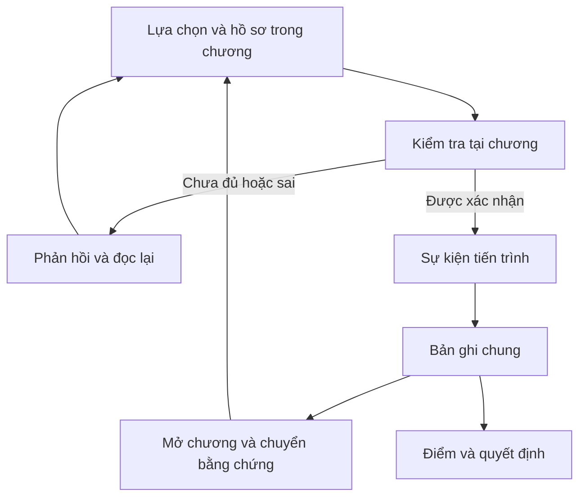

# WEEK 6 — BUILD, INTEGRATION AND TESTING

**Dự án:** The Last Heir  
**Học phần:** NHA408E · **Nhóm:** G08 · **Tuần:** 6

## 1. Purpose and Document Map

Tuần 6 kiểm tra các thành phần đã thiết kế có được kết nối đúng với đầu vào, logic, đầu ra và hành động của người học hay chưa. Phạm vi là tình huống Aster Foods gồm năm chương, không tạo thêm một luồng khái niệm hoặc vụ việc mới.

Bản đối chiếu là `THE_LAST_HEIR_FULL_GAME_FINAL(3).html`, dung lượng 120.507.192 byte. Ngày rà soát 21/10/2026; các tuần thể hiện nhóm nội dung bàn giao, không được dùng để suy ra lịch sử hoàn thành từng tính năng khi chưa có bằng chứng tiến độ gốc.

Bản đã dùng cho các phép kiểm tra được lưu tên `THE_LAST_HEIR_FULL_GAME_FINAL(3).html`. Theo kết quả đối chiếu trong tệp phản hồi `THE_LAST_HEIR_Documentation_Revision_Plan(2).docx`, bản `THE_LAST_HEIR_FULL_GAME_FINAL(8).html` có cùng dung lượng 120.507.192 byte và cùng SHA-256 `aa2e501a80c7abea6948f2a5c1a7de73f0853e0d188bf4598c53dac24a431f42`. Tệp (3) sẵn có đã được băm lại và khớp giá trị này; thông tin đồng nhất với tệp (8) được dẫn theo biên bản phản hồi. Vì vậy, giữ tên (3) trong hồ sơ kiểm tra để truy vết, đồng thời ghi nhận tên (8) của bản được dùng trong phản hồi.

| Tệp | Vai trò |
|---|---|
| [WEEK_6_BUILD_INTEGRATION_TESTING_FINAL.md](WEEK_6_BUILD_INTEGRATION_TESTING_FINAL.md) | Tổng quan bản chạy, kiến trúc, tích hợp và quyết định mức sẵn sàng |
| [TEST_CASES_FINAL.md](TEST_CASES_FINAL.md) | Đầu vào, kỳ vọng, kết quả thực tế và kế hoạch kiểm tra giao diện |
| [BUG_LOG_FINAL.md](BUG_LOG_FINAL.md) | Vấn đề có căn cứ, bước tái hiện, ưu tiên và xác nhận sau sửa |
| [SCOPE_FREEZE_FINAL.md](SCOPE_FREEZE_FINAL.md) | Phạm vi chốt, phần hoãn, giới hạn và điều kiện hoàn tất |
| [README.md](README.md) | Cách dùng bộ hồ sơ, chạy trò chơi và chạy lại kiểm tra |
| [CONTRIBUTION_EVIDENCE_FINAL.md](CONTRIBUTION_EVIDENCE_FINAL.md) | Đầu mối và yêu cầu bằng chứng đóng góp |
| `EVIDENCE/` | Danh mục bản chạy, 40 kết quả logic, 18 kết quả dữ liệu và trạng thái kiểm tra trình duyệt |
| `SAMPLE_DATA/`, `SCRIPTS/` | Dữ liệu mẫu và mã kiểm tra có thể chạy lại |

## 2. Protected Core Flow

Luồng cốt lõi cần cho phép người học nhận diện chênh kế hoạch 3,0, khoanh vùng tư vấn 2,6, xác lập NST-01, đối chiếu kiểm soát, kiểm tra lời khai, khóa trách nhiệm và đọc biên bản. Ba quyết định quản trị tạo phần đánh giá sau điều tra.

| Điểm nối | Dữ liệu phải giữ | Đầu ra cần nhận |
|---|---|---|
| I → II | Chênh kế hoạch tiếp thị và quản lý | 3,0 cần phân rã |
| II → III | Cơ sở, số ghi nhận và phần tư vấn còn mở | 2,6 cần truy vết |
| III → IV | Ranh giới, tổng và giới hạn kết luận | NST-01 / ROP-25 bằng 2,6 |
| IV → V | Dữ kiện đã xác lập cùng nhận định sử dụng | Hồ sơ kế thừa có giới hạn; có thể yêu cầu lại nguồn thiếu |
| V → quản trị | Trách nhiệm, xung đột lợi ích, kiểm soát và gian lận | Ba quyết định, kết thúc và điểm |

## 3. Technical Integration

### 3.1 Packaging and Runtime

Tệp chính chứa năm khối chương nén gzip, mã hóa base64. Trình duyệt giải nén bằng `DecompressionStream` rồi đặt HTML vào `iframe.srcdoc`. Chương I–IV có lớp nội dung gốc nhúng; Chương I còn có lớp phân tích bên trong.

| Thành phần | Kết nối thực tế |
|---|---|
| Hồ sơ và điều khiển của chương | JavaScript của chương đọc dữ liệu nhúng, kiểm tra thao tác |
| Bộ ghi lỗi | Ghi lỗi mới, giải phóng tạm dừng khi đọc lại hoặc hết 15 giây |
| Sự kiện chương | Gửi điểm kiểm tra, hoàn thành, hỗ trợ, hết giờ và dữ kiện |
| `TLH_GAME.receive()` | Chuẩn hóa và lưu trạng thái dùng chung |
| Điều hướng | Kiểm tra các chương trước; mở bàn giao và chuyển chương |
| `metrics()` và `calculate()` | Tính điểm, kết thúc và danh hiệu |
| Lưu trình duyệt | Bản ghi chung và trạng thái chương gắn với mã lượt |
| Bắt đầu lại | Xác nhận xóa toàn bộ tiến trình và trạng thái liên quan |

### 3.2 State and Boundary Rules

Đã xem, đang dùng và đã xác lập là trạng thái dữ kiện; tự giải, xem lời giải và hết giờ là trạng thái điểm kiểm tra. Hoàn thành chương là trạng thái cấp chương. Không thay các lớp này bằng một trạng thái “đã đọc” chung.

Bộ nhận bảo toàn kết quả đã khóa, đồng thời cho phép nhận sự kiện thành công cuối còn thiếu ngay sau thông báo hoàn thành. Hàm tính kết quả trực tiếp kiểm tra ba quyết định; việc bảo đảm tiến trình năm chương thuộc luồng giao diện và cần kiểm thử tích hợp riêng.

## 4. Build and Data Inventory

Đã giải nén trực tiếp cả năm chương bằng Node.js. Bảng này xác nhận khả năng giải nén trong môi trường kiểm tra, chưa xác nhận tốc độ nạp hoặc hiển thị trong trình duyệt.

| Chương | Dung lượng HTML giải nén, byte | Dữ liệu đã đối chiếu |
|---|---:|---|
| I | 23.812.579 | 21 tài liệu và các số báo cáo |
| II | 7.761.526 | 5 tài khoản, 20 chứng từ, bảng vai trò |
| III | 7.501.758 | 9 bút toán, 7 hợp đồng, 9 bàn giao |
| IV | 7.788.213 | Hồ sơ kiểm soát và báo cáo đủ 10 dòng |
| V | 17.413.553 | 13 hồ sơ, 5 lời khai, 4 cấu hình trách nhiệm |

Định danh bản chạy, mã băm và số lượng chi tiết nằm trong [build_inventory.json](EVIDENCE/build_inventory.json). JSON mẫu được đối chiếu với số báo cáo và giao dịch của HTML; không coi nó là nguồn được trò chơi tự nạp.

## 5. Integration Audit

| Kết nối | Kỳ vọng | Kết quả thực tế | Mức xác nhận |
|---|---|---|---|
| Đóng gói → nội dung chương | Đọc đủ năm chương | Giải nén thành công | Đã chạy bằng Node.js |
| Báo cáo → số liệu chuẩn hóa | Số hai năm khớp HTML | F15 khớp | Đã đối chiếu dữ liệu |
| Giao dịch → hợp đồng, bàn giao | Không thiếu tham chiếu | F10–F11, F16 khớp | Đã đối chiếu dữ liệu |
| Chương → bộ nhận điểm | Mã điểm và kết quả được ghi | Danh sách 45 mã; các tình huống L01–L31 khớp | Đã chạy một phần logic điều phối |
| Dữ kiện IV → bản ghi chung | Có mã dữ kiện, mã nguồn, nội dung và nhận định sử dụng | L15–L16 khớp | Đã chạy bộ nhận, chưa xác nhận đủ giao diện V |
| Bằng chứng V → chấp nhận lời khai | Đúng tập và đúng đánh giá | L32–L36 khớp | Đã chạy hàm gửi với phần giao diện thay tối thiểu |
| Ghi lỗi → tạm dừng, gợi ý | Đúng lỗi mới, 15 giây hoặc đọc lại | L37–L40 khớp | Đã chạy bộ ghi lỗi với đồng hồ kiểm soát |
| Trình duyệt → toàn bộ hành trình | Hoàn thành qua các màn hình | Chưa chạy xác nhận | Cần kiểm thử giao diện |
| Lưu, khôi phục → tiếp tục | Giữ trạng thái và thời gian | Chưa chạy xác nhận | Cần kiểm thử trên máy đích |

Không có sai khác trong 40 tình huống logic và 18 phép dữ liệu đã chạy. Kết quả này không được viết thành không có lỗi chặn ở toàn bộ sản phẩm hoặc đã kiểm thử mọi thành phần.

## 6. Testing and Issue Handling

[TEST_CASES_FINAL.md](TEST_CASES_FINAL.md) phân loại trường hợp điển hình, biên, không hợp lệ và nhất quán tài chính. Kỳ vọng được xác định trong mã kiểm tra trước khi đối chiếu kết quả; các trường hợp chưa chạy giữ trạng thái riêng.

[BUG_LOG_FINAL.md](BUG_LOG_FINAL.md) ghi các sai lệch dữ liệu, giới hạn thiết kế và lỗi tài liệu đã sửa. Vấn đề trình duyệt chưa tái hiện không được ghi như lỗi trò chơi đã xác nhận; ví dụ không có bằng chứng mới để giữ kết luận “0 lỗi JavaScript” hoặc thời gian nạp 4 giây.

Ưu tiên xử lý:

1. Lỗi chặn hoàn thành, sai kết quả tài chính hoặc mất dữ liệu đã khóa.
2. Sai chuyển bằng chứng, thời gian, điểm hoặc trách nhiệm.
3. Diễn giải gây hiểu sai giới hạn và hướng dẫn chạy thiếu.
4. Bố cục, hình ảnh, âm thanh sau khi các phần trên ổn định.

## 7. Distribution and Working Build Status

Tệp HTML là bản chạy được cung cấp để đối chiếu. Bộ tài liệu không kèm lại khối đa phương tiện 120,5 MB; hướng dẫn sử dụng đúng tệp hiện có nằm trong [README.md](README.md).

| Nội dung | Trạng thái |
|---|---|
| Có tệp HTML đầy đủ | Đã có |
| Năm chương giải nén được bằng Node.js | Đã xác nhận |
| Logic và dữ liệu trong tập kiểm tra | 40/40 và 18/18 khớp |
| Chơi trọn luồng qua giao diện | Chưa xác nhận trong đợt rà soát |
| Chạy trên trình duyệt, thiết bị khác | Chưa có kết quả mới |
| Đường dẫn phân phối hiện hành | Chưa có đường dẫn đã xác nhận |
| Bản tách chương hoặc giảm đa phương tiện | Phương án dự kiến, chưa xác nhận gói dự phòng |

Việc chuẩn bị môi trường trình duyệt tự động trong đợt rà soát chưa thành công, nên các kiểm tra giao diện được giữ là chưa chạy. Chi tiết phạm vi có trong [browser_checks.json](EVIDENCE/browser_checks.json); đây là giới hạn môi trường kiểm tra, không phải kết luận bản trò chơi không chạy.

## 8. Scope, Ownership and Readiness Decision

Phạm vi chốt là tình huống hiện tại; không thêm vụ việc, máy chủ, tài khoản hoặc mô hình mới. [SCOPE_FREEZE_FINAL.md](SCOPE_FREEZE_FINAL.md) nêu phần được sửa, giới hạn và điều kiện kết thúc.

Phương tổng hợp, Dũng đối chiếu tài chính, Hiền phụ trách quy tắc và kiểm tra, Ngọc phụ trách hồ sơ, Khuê phụ trách tích hợp. Bằng chứng đóng góp được ghi riêng, không dùng kết quả rà soát tự động để suy thành biên bản chơi thử của thành viên.

Quyết định hiện tại là **giữ phạm vi, tiếp tục kiểm thử tích hợp và xác nhận phân phối**. Chưa ghi đủ điều kiện trình diễn hoàn chỉnh chỉ dựa trên các phép kiểm tra hàm. Điều kiện hoàn tất là đi hết luồng giao diện, xác nhận lưu và thời gian, xử lý lỗi quan trọng, kiểm tra máy đích và cập nhật đường dẫn bàn giao thực tế.
